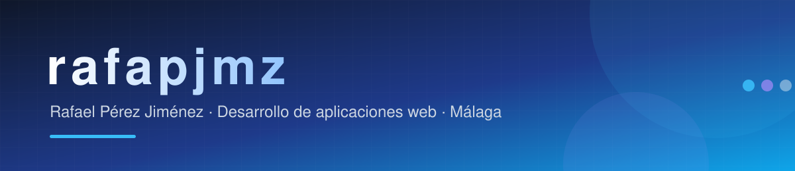

  

# Rafael Pérez Jiménez

Desarrollador web en formación: curso **DAW** en Davante Medac (Málaga) y grado en **Ingeniería de diseño industrial y desarrollo del producto** por la Universidad de Málaga. Me muevo entre el código y el diseño, y me interesan el **frontend**, el **diseño** y la **inteligencia artificial**. Busco un equipo donde aprender rápido y aportar desde el primer día.

## 🛠️ Tecnologías

- **Frontend:** HTML, CSS, JavaScript, TypeScript
- **Backend:** PHP, Java, C
- **Herramientas:** Git, GitHub, Adobe Illustrator, Microsoft 365

## 🌱 En aprendizaje · nivel básico

React, Angular y Laravel. Los estoy incorporando este curso para poder defenderlos cuando entre en una empresa.

## 💡 Intereses

- Frontend y experiencia de usuario
- Diseño: ilustración y fotografía de eventos
- Inteligencia artificial aplicada al desarrollo web

## 🎓 Formación

- **Grado Superior en Desarrollo de Aplicaciones Web** — Davante Medac, Málaga (2025 – presente)
- **Grado en Ingeniería de diseño industrial y desarrollo del producto** — Universidad de Málaga (2020 – presente)

## 📂 Proyectos

1. **Ruleta de retos DWCLE** — Generador aleatorio de retos de programación con filtros, pista y lista guardada; practica `map`, `filter` y `reduce` con JavaScript. [Código](https://github.com/rafapjmz/reto-aleatorio-daw) · [Demo](https://rafapjmz.github.io/reto-aleatorio-daw/)
2. **Portfolio personal** — Web responsive con presentación, tecnologías, proyectos y contacto, publicada con GitHub Pages. [Código](https://github.com/rafapjmz/rafapjmz) · [Demo](https://rafapjmz.github.io/rafapjmz/)
3. **DWCLE — Desarrollo Web en Entorno Cliente** — Plantilla de trabajo con TypeScript, Vite, ESLint, Prettier y Vitest utilizada en el módulo de DAW. [Repositorio](https://github.com/rafapjmz/DWCLE-Perez-Rafael/tree/main/template)
4. **Prácticas de JavaScript** — Ejercicios de control de flujo, arrays y programación funcional del mismo módulo. [Repositorio](https://github.com/rafapjmz/DWCLE-Perez-Rafael/tree/main/02-JavaScript)

## 🐍 Mi serpiente de contribuciones

## 📫 Contacto

- 📧 [rafapj.01@gmail.com](mailto:rafapj.01@gmail.com)
- 💼 [LinkedIn](https://www.linkedin.com/in/rafaei-alberto-p%C3%A9rez-jim%C3%A9nez-354017199/)
- 📍 Málaga, España

Con un poco de ayuda de IA.

